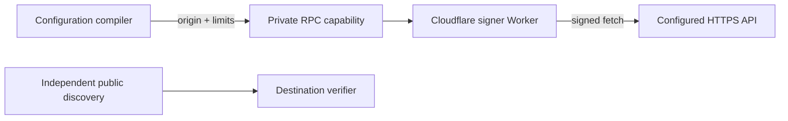

# Workload identity bindings

```ts
const assertion = await env.API_TOKEN.getToken();
const grant = await env.API_TOKEN.getAuthorizationGrant({
  authorizationServer: "https://auth.example.com",
  scope: ["issues:read"],
});
const response = await env.API_TOKEN.fetch("https://api.example.com/issues");
```

EWC compiles each binding into a private service capability with protected origin
properties and destination limits. A Cloudflare-owned Worker signs each JWT or
signs and sends each HTTP request. Deployed calls need no live EWC authorization.



| Profile | Subject |
| --- | --- |
| Worker | `worker:W` |
| Preview | `worker:W:preview:P` |
| Namespace | `durable-object-namespace:N` |

Each getter returns a fresh five-minute JWT. Configure one audience per binding;
`getToken()` takes no arguments. WAG and HTTP signing require their own limits
and disjoint signing keys.

Forwarding a binding through Workers RPC preserves its originating account,
Worker, version, subject, and limits. It shares that authority. It does not attest
the recipient or current caller. Editing configuration constrains new bindings;
existing handles have no promised invalidation deadline.

Use normal service bindings and RPC forwarding. No native signer, per-object
identity hook, token cache, identity resource, or assignment approval belongs in
workerd. Local tooling reports unsupported issuance; use deployed Previews or
explicit test mocks.
