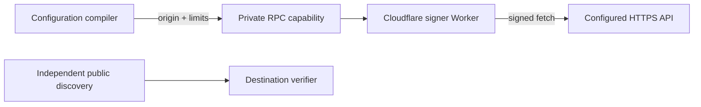

# Workload identity bindings

```ts
const assertion = await env.API_TOKEN.getToken();
const grant = await env.API_TOKEN.getAuthorizationGrant({
  authorizationServer: 'https://auth.example.com',
  scope: ['issues:read'],
});
const identity = await env.API_TOKEN.getIdentity();
const response = await identity.fetch('https://api.example.com/issues');
```

EWC compiles each binding into a private service capability with protected origin
properties and destination limits. A Cloudflare-owned Worker signs each JWT or
signs and sends each HTTP request. Deployed calls need no live EWC authorization.



| Profile   | Subject                      |
| --------- | ---------------------------- |
| Worker    | `worker:W`                   |
| Preview   | `worker:W:preview:P`         |
| Namespace | `durable-object-namespace:N` |

Each token or grant call returns a fresh five-minute JWT. Configure one audience
per binding;
`getToken()` takes no arguments. WAG and HTTP signing require their own limits
and disjoint signing keys.

Forwarding a binding through Workers RPC preserves its originating account,
Worker, version, subject, and limits. It shares that authority. It does not attest
the recipient or current caller. Editing configuration constrains new bindings;
existing handles have no promised invalidation deadline.

Use normal service bindings and RPC forwarding. No native signer, per-object
identity hook, token cache, identity resource, or assignment approval belongs in
workerd. Local tooling reports unsupported issuance; use deployed Previews or
explicit test mocks.

## Direct JSRPC

The binding is the service stub itself. The signer Worker implements token/grant
methods and returns a service-hosted `RpcTarget` from `getIdentity(label?)`.
No identity-specific runtime module, wrapper or compatibility flag is needed.
The workerd integration consists of public types and standard RPC tests.

```ts
using customer = await env.API_TOKEN.getIdentity('customer-x');
const signatureAgent = await customer.signatureAgent;
const response = await customer.fetch('https://api.example.com/issues');
```

Identity metadata getters are remote: await `id`, `signatureAgent` and
`directoryURL`. Copies and forwarding follow ordinary RPC `dup()` and disposal
rules. Handles retain their original parent and fixed selection. They expose
no nested minting, JWT or authorization-grant methods.

The root binding exposes `getIdentity()`, `getToken()` and
`getAuthorizationGrant()`. Use `getIdentity().fetch()` for the default identity
and `getIdentity(label).fetch()` for a labeled identity. Every signed fetch is
an ordinary RPC method: pass a string or `Request` and RPC-safe options. Normalize
URL objects, FormData and URLSearchParams at the call site
with `new Request(url, init)` before passing them to the handle. The service
validates limits before consuming the body and strips all caller identity
selector headers. There is no label-selection header transport or RPC preflight.

A runtime wrapper requires a documented requirement standard JSRPC cannot meet,
a reproducer, an API/transport alternatives analysis and explicit design review.
Do not add one solely for API convenience or to expose a first-class binding.

The service entrypoint's native HTTP handler rejects use. Native service Fetcher
special cases such as local `data:` URL handling are outside the public binding
API. Identity-target fetch validates every destination before reading its body.

Identity-target fetch options exclude `signal`. Cross-RPC AbortSignal transport
and cancellation are outside this contract. A Request without an explicit signal
can be passed normally; an explicitly signaled Request can fail standard RPC
serialization. Disposing a stub, dropping an await or timing out the caller does
not promise to stop remote work or undo a dispatched write. No experimental
AbortSignal compatibility flag is required by the identity binding.
